# 02 — Architecture

## 1. Shape

One deployable service: a Python web app that serves the API and the static front end, and runs the scan scheduler in the same process. One replica. It is a single-team tool with modest volume, so a single process is simpler to secure and operate than a queue plus workers.

```mermaid
flowchart LR
  subgraph Scheduler
    T[Timer: every SCAN_INTERVAL_MIN] --> QP[Query planner]
  end
  QP -->|keyword + place queries| SC[SocialCrawl collector]
  QP --> EX[Exa collector]
  QP --> FC[Firecrawl collector]
  SC & EX & FC --> N[Normalize to NormalizedItem]
  N --> D[De-duplicate: url + content hash]
  D --> DF[Date filter: published_at within INGEST_MAX_AGE_DAYS]
  DF --> PF[Prefilter: homelessness term AND LI place term AND no exclusion]
  PF --> CL[Claude classifier: strict JSON verdict]
  CL --> V[Verifier: quotes and location are substrings; recency; type rules]
  V --> G[Geocoder: gazetteer, then Nominatim bounded to LI]
  G --> GF[Geofence: point in Nassau or Suffolk polygon]
  GF --> P[Privacy scrubber R1-R7]
  P --> DB[(Database)]
  DB --> H[Hotspot aggregator]
  H --> DB
  DB --> API[FastAPI REST + SSE]
  API --> UI[3D map + feed SPA / PWA]
  DB --> RJ[Retention job: purge > RETENTION_DAYS]
```



Every arrow is a function call inside one process. Each stage records counts in, counts out, and drop reasons into the `scan_runs` row, so the UI can show exactly where items were filtered.

## 2. Tech stack

| Layer | Choice | Why |
|---|---|---|
| Language | Python 3.12 | One language for pipeline, API and data scripts |
| Web | FastAPI + Uvicorn | Async I/O for many provider calls; built-in OpenAPI docs |
| HTTP to providers | `httpx` (async) with per-provider timeouts and retry/backoff | SocialCrawl, Exa and Firecrawl are plain REST |
| LLM | Official `anthropic` Python SDK, `AsyncAnthropic` client | Required by Anthropic guidance. Note: SDK 1.x is built on `httpx2`. Keep the app's `httpx` usage separate from the SDK's client. [verify installed major version] |
| Database | SQLAlchemy 2.x + Alembic. SQLite file on a Railway volume for the pilot; Postgres (`DATABASE_URL`) when more than one person administers it | SQLite is enough for one replica; the schema is portable |
| Geometry | `shapely` (point-in-polygon, distance), `rapidfuzz` (fuzzy place-name matching) | Fast, offline |
| Scheduling | In-process asyncio loop (or APScheduler), plus a DB lock row so two processes never scan at once | No extra infrastructure |
| Live updates | Server-Sent Events (`text/event-stream`), e.g. `sse-starlette` | One-way push is all the UI needs; works through Railway's proxy |
| Auth | Session cookie (signed, HttpOnly, Secure, SameSite=Lax); passwords hashed with Argon2id (`argon2-cffi`) | Small user list, no SSO needed for pilot |
| Front end | No-build ES modules + **MapLibre GL JS** + **deck.gl** (vendored into `/static/vendor/` at Docker build time), plain CSS with design tokens | Portable, fast, no Node toolchain at runtime |
| Packaging | Dockerfile (multi-stage: `node` stage only to fetch vendor libs; `python:3.12-slim` runtime) | Railway builds it directly |

**Versions [verify at build]:** current stable MapLibre GL JS 5.x and deck.gl 9.x; `anthropic` 1.x. Pin exact versions in `requirements.txt` / `package.json` and record them in the README.

## 3. Repository layout

```
pit-radar/
  Dockerfile
  railway.json
  requirements.txt
  package.json                 # only to fetch maplibre-gl + deck.gl into static/vendor
  alembic/ ...
  app/
    main.py                    # FastAPI app factory, static files, middleware
    config.py                  # pydantic-settings; reads env (see config/.env.example)
    db.py, models.py           # SQLAlchemy engine + ORM models (docs/03)
    auth.py                    # login, sessions, roles, rate limiting
    api/                       # routers: hotspots, signals, self_reports, scans, stream, export, admin
    pipeline/
      planner.py               # builds the query list for a scan (docs/04 §6)
      collectors/
        base.py                # Collector protocol, budget accounting
        socialcrawl.py         # runtime endpoint discovery + adapters (docs/04 §2)
        exa.py                 # docs/04 §3
        firecrawl.py           # docs/04 §4
      normalize.py             # provider payload -> NormalizedItem
      dedupe.py, datefilter.py, prefilter.py
      classifier.py            # Claude call + JSON validation (docs/05)
      verifier.py              # quote/location/recency checks (docs/05 §5)
      geo/
        gazetteer.py           # exact/alias/fuzzy match (docs/06)
        nominatim.py           # bounded fallback geocoder with cache + 1 req/s
        geofence.py            # shapely point-in-polygon
        snapping.py            # public-place snapping (R5)
      privacy.py               # R1-R7 scrubbing (single choke point before DB)
      hotspots.py              # clustering + scoring (docs/03 §4)
      runner.py                # orchestrates a scan, records stage counts
      retention.py             # purge job (R6)
    events.py                  # in-process pub/sub feeding SSE
  data/
    li_counties.geojson        # built by scripts/build_geo.py (docs/06)
    li_places.json             # gazetteer
  config/
    lexicon.yaml, sources.yaml
  prompts/classifier-system.md
  schemas/*.json
  static/
    index.html, app.js, map.js, feed.js, planner.js, styles.css
    manifest.webmanifest, sw.js, icons/
    vendor/ (built)
  scripts/
    build_geo.py               # fetch + build geography data (run with network)
    create_user.py             # CLI to add users (prints nothing secret)
    smoke_providers.py         # live smoke test of each provider (manual)
  tests/ ...
```

## 4. Scan lifecycle

1. **Acquire lock** (`scan_lock` row with a TTL). Skip if another scan holds it.
2. **Plan** (`planner.py`): region-wide queries every scan, plus the next batch of place names from the rotation cursor (docs/04 §6). Check budgets first: daily SocialCrawl credits, Exa and Firecrawl request caps, and LLM dollars.
3. **Collect** in parallel with a concurrency limit per provider (SocialCrawl ≤ 10 in flight; its documented limit is 50 [verified]). Handle each provider's errors separately, so one failing provider never fails the scan.
4. **Normalize → de-duplicate → date filter → prefilter.** All are cheap and deterministic.
5. **Classify** survivors with Claude, ≤ `LLM_CONCURRENCY` (default 4) at a time, stopping at `MAX_CLASSIFICATIONS_PER_SCAN` or the daily dollar budget. Unclassified survivors carry over to the next scan in priority order: newest first, then those with the strongest prefilter score.
6. **Verify → geocode → geofence → privacy scrub → persist** `signals` rows.
7. **Re-aggregate** the hotspots touched by new signals.
8. **Publish** SSE events (`signal.new`, `hotspot.updated`, `scan.finished` with stage counts).
9. **Release lock.** Record usage (credits, requests, tokens, dollars) in `api_usage`.

The retention job runs hourly, separately (docs/09 §4).

## 5. Failure behavior

| Failure | Behavior |
|---|---|
| A provider returns 401/402/403 | Mark provider `unhealthy` with the reason (bad key / out of credits / forbidden); skip it until an admin clears it or the next day; show it in the health panel |
| 429 / 5xx / timeout | Retry with exponential backoff (honor `Retry-After`), max 3 attempts, then mark the query `deferred` |
| Claude refusal (`stop_reason == "refusal"`) | Server-side fallback first (docs/05 §3). If the final response is still a refusal, store the item as `needs_human_review` with no AI verdict; never guess |
| Claude returns invalid JSON or a schema violation | One retry; then `needs_human_review` |
| Geocoder unavailable | Keep the signal `unlocated` (not mapped); retry geocoding next scan |
| Budget exhausted | Stop classifying, keep collected items queued, show a banner in the UI |
